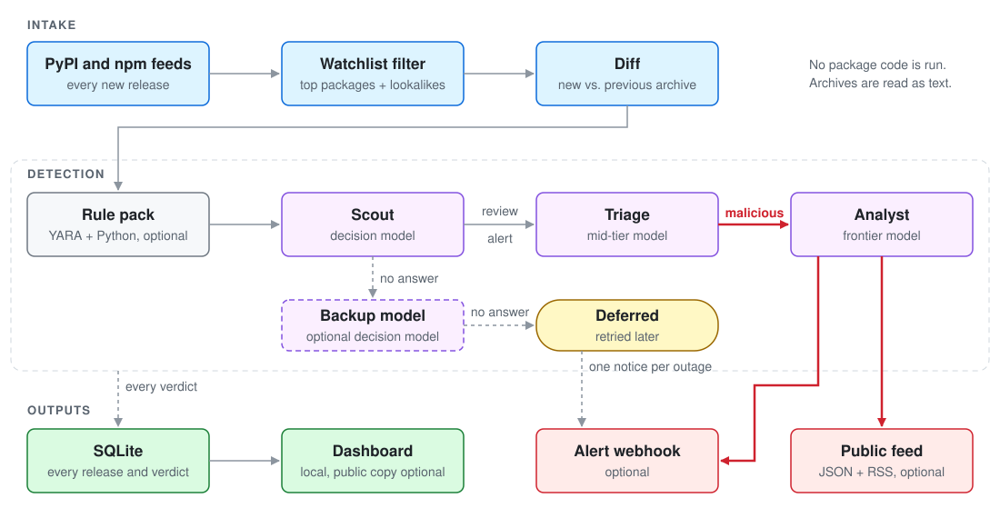

# Supply Chain Hunter

[](https://github.com/SecOps-AG/Supply-Chain-Hunter/actions/workflows/ci.yml)

Catch malicious npm, PyPI, and GitHub Actions releases by reviewing what changed in each new version.

Hunter watches the most-downloaded PyPI and npm packages for malicious releases. When a new version is published, it downloads that archive and the previous one, diffs them, and has a chain of models review the change. It never installs a package or runs any of its code.

> **Status: beta.** Detection quality depends on the models you plug in. Expect false positives and tune before relying on it.

## How it works

<picture>
  <source media="(prefers-color-scheme: dark)" srcset="docs/images/pipeline-dark.svg">
  
</picture>

1. **Intake.** Hunter polls the PyPI and npm feeds and queues releases of watched packages (the top 15,000 per ecosystem by downloads) and of packages whose names imitate them. It diffs each release against the previous version.
2. **Rule pack (optional).** YARA and Python rules flag known-bad patterns in the added text. A strong rule hit always sends the release on to Triage. Rules never alert on their own.
3. **Scout, the decision model.** A low-cost classifier answers many narrow yes/no questions about the diff. Local checks add signals such as new install scripts, new executables, typosquats and unused dependencies. A scoring model turns all of it into a band: `benign`, `review` or `alert`. If Scout cannot answer, an optional backup model rereads the release; otherwise it is `deferred` and retried, and the webhook gets one notice per outage.
4. **Triage, the mid-tier model.** Reads a filtered diff of every `review` and `alert` release, plus `benign` ones that show a new warning sign, and ends with a verdict.
5. **Analyst, the frontier model.** Reads the same diff only when Triage says malicious. Its malicious verdict is the only thing that sends an alert.

Every release and verdict is stored in SQLite. Releases Scout only read in part are marked as partial reads all the way through to the alert. Details are in [docs/detection.md](docs/detection.md).

## Models

Each role is a setting, not a fixed product.

| Role | Runs on | Backends |
| --- | --- | --- |
| Scout (decision model) | every watched release | Jev (default) or Clef. It must return a probability per question, so chat models can't fill this role. |
| Triage (mid-tier model) | `review`, `alert` and flagged `benign` releases | Cursor Agent CLI (default), any OpenAI-compatible API, the Anthropic API, OpenRouter, or your own command |
| Analyst (frontier model) | releases Triage calls malicious | Same choices as Triage, configured separately |

Scout runs on thousands of releases a day, so its cost matters most. Triage runs on a small share of them and the Analyst rarely.

## Install

Python 3.11 or newer.

```bash
python -m venv .venv
source .venv/bin/activate
pip install -e ".[dev]"
```

This installs the `supply-chain-hunter` distribution from your checkout. The Python package and the command are both named `hunter`.

## Run

With the defaults (Jev for Scout, the Cursor Agent CLI for Triage and Analyst):

```bash
export TYPESAFE_API_KEY=...                                  # Scout
export CURSOR_API_KEY=...                                    # Triage and Analyst
export HUNTER_ANALYST_MODEL=<frontier model id>
export ALERT_WEBHOOK_URL=https://example.com/hooks/hunter    # optional
python -m hunter serve
```

With an OpenAI-compatible provider for Triage and Analyst:

```bash
export TYPESAFE_API_KEY=...
export HUNTER_SMART_BACKEND=openai                           # or anthropic, openrouter
export HUNTER_SMART_BASE_URL=https://api.example.com/v1
export HUNTER_SMART_API_KEY=...
export HUNTER_SMART_MODEL=<mid-tier model id>
export HUNTER_ANALYST_MODEL=<frontier model id>
python -m hunter serve
```

The first start records each feed's position and does not replay history; later starts resume from the saved checkpoint. `--since-hours 6` replays the last six hours. Every setting, with its default, is in [docs/configuration.md](docs/configuration.md).

## Commands

| Command | What it does |
| --- | --- |
| `python -m hunter serve` | Poll the feeds until stopped. |
| `python -m hunter scan --once` | Poll once, process the queue, send pending alerts, and exit. |
| `python -m hunter score --ecosystem npm --name left-pad --old 1.0.0 --new 1.0.1` | Score one release from the registry (or two local archives with `--old-archive` / `--new-archive`). |
| `python -m hunter report exhausted` | List releases that failed analysis too many times. |
| `python -m hunter eval` | Score the bundled synthetic fixtures offline and print precision and recall. |
| `python -m hunter models` | Show the configured Scout, Triage and Analyst models. |

## Outputs

- **SQLite** (`HUNTER_DB`, default `./hunter.sqlite3`): every release, band, signal, report and verdict, plus the alert outbox.
- **Alert webhook** (optional, `ALERT_WEBHOOK_URL`): a POST for each confirmed malicious release, as JSON or as a Slack-compatible text message. It can be signed with an HMAC (`ALERT_WEBHOOK_SECRET`), and failed deliveries retry across restarts.
- **Dashboard**: a read-only page at `http://127.0.0.1:8080/` with the pipeline, findings and per-release reports, plus a benchmark tab. `/health` reports status, queue depths and spend.
- **Public feed and dashboard** (optional): confirmed malicious releases as `feed.json` and `feed.xml`, and a sanitized copy of the dashboard data, published to a Cloudflare R2 bucket. Releases still under review are labeled as such, and verdicts are labeled as AI verdicts. See [docs/public-dashboard.md](docs/public-dashboard.md).
- **Logs** (`HUNTER_LOG_DIR`, default `./logs`): one line per release.

A JSON alert looks like this (some fields left out):

```json
{
  "kind": "smart_analysis",
  "ecosystem": "npm",
  "package": "color-hex-pad",
  "old_version": "2.4.0",
  "new_version": "2.4.1",
  "registry_url": "https://www.npmjs.com/package/color-hex-pad/v/2.4.1",
  "primary_band": "review",
  "malice_probability": 0.62,
  "signals": ["phantom_runtime_dependency:codec-pad"],
  "analysis": "…the analyst write-up…\nVerdict: malicious",
  "verdict": "malicious",
  "partial_read": false
}
```

## Public dashboard

Hunter can publish a read-only copy of its dashboard as a static site, so others can follow what it is watching without access to the machine that runs it. `serve` uploads sanitized JSON to a Cloudflare R2 bucket, and the page in `public_dashboard/` reads it from Cloudflare Pages. The page shows releases scanned per feed, the rule pack, Scout bands, Triage and Analyst verdicts, alerts sent, recent activity, findings with per-release reports, and a benchmark tab. Releases still under review are labeled "under review, not a verdict", and Analyst verdicts are labeled as AI verdicts that may be wrong.

The public copy leaves out secrets, webhook addresses, internal paths, raw errors, queue sizes, budgets, spend, and the model ids behind each role. Setup is in [docs/public-dashboard.md](docs/public-dashboard.md).

## Deploy

`deploy/hunter.service` is a systemd unit. Copy it to `/etc/systemd/system/`, create `/var/lib/hunter`, put your settings in `/etc/hunter.env` (never commit keys or webhook URLs), then:

```bash
sudo systemctl daemon-reload
sudo systemctl enable --now hunter
curl -s http://127.0.0.1:8080/health
```

## Tests

```bash
pytest
python -m hunter eval
```

The suite makes no network calls; the model APIs are mocked. Files under `fixtures/` are short synthetic diffs, not real malware.

## Security

Hunter reads untrusted package contents and sends parts of them to the models you configure. It never executes them. To report a vulnerability in Hunter itself, see [SECURITY.md](SECURITY.md).

## License

MIT License. See [LICENSE](LICENSE). Vendored files keep their own licenses: `hunter/clef_tokenizer/` (Apache-2.0, with its own NOTICE) and `hunter/jev_count/` (MIT).
